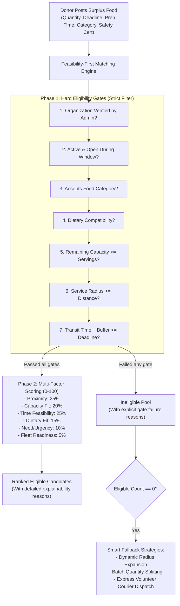
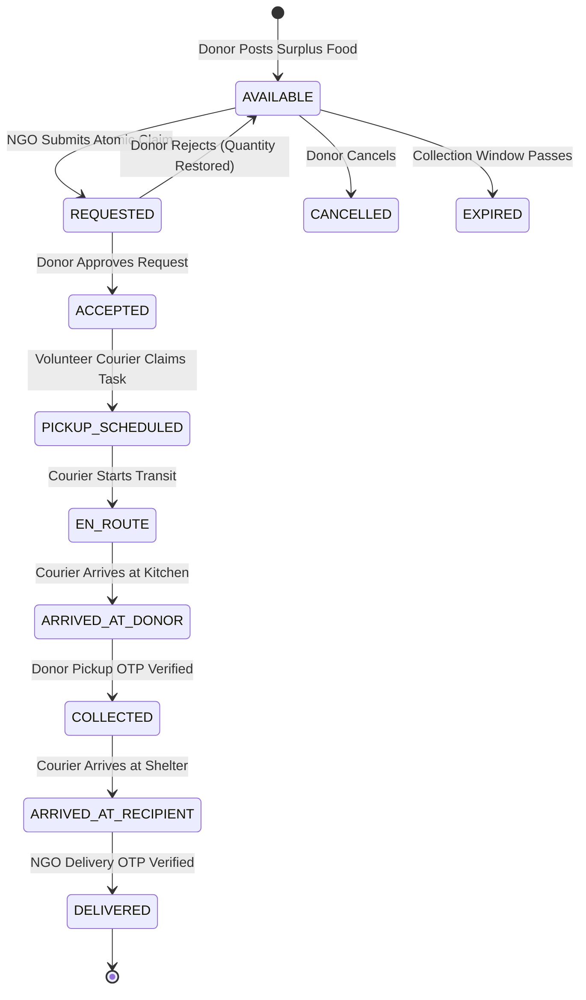
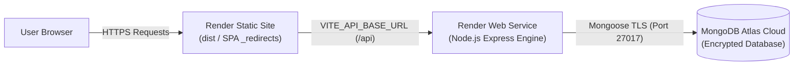

# FoodLoop — Intelligent Surplus Food Rescue Network
> **Rescue Surplus. Deliver Hope.**  
> *Connect surplus food from commercial kitchens with verified community organizations before the collection window closes.*

---

## 1. System Overview & The Core Innovation

**FoodLoop** is a production-ready, full-stack social-impact web application designed to eliminate edible food waste from restaurants, hotels, bakeries, caterers, and supermarkets by connecting them with verified shelters, community kitchens, and food distribution organizations.

### The Innovation: Feasibility-First, Deadline-Aware Matching Engine

Most existing platforms treat food donation like classified ads or sort by naive straight-line distance. This often leads to food spoiling during transit, shelters receiving items they cannot safely store (e.g., lack of refrigeration), or dietary mismatches (e.g., meat delivered to pure vegetarian shelters).

FoodLoop introduces a **deterministic, explainable two-phase decision engine**:



---

## 2. Technology Stack

- **Frontend**: React 18, Vite, Tailwind CSS, React Router v6, Lucide React, Recharts, Leaflet, React-Leaflet, Axios.
- **Backend**: Node.js, Express.js, MongoDB, Mongoose ORM.
- **Authentication & Security**: JWT with Bearer tokens, bcryptjs (salt factor 10), Helmet HTTP security headers, Express Rate Limiter, CORS protection.
- **Handover Security**: Cryptographic SHA-256 verification codes (dual 6-digit OTP verification at collection & delivery).
- **Testing**: Jest test runner, Node.js native test suite.

---

## 3. Four User Roles & Server-Enforced Permissions

| Role | Primary Dashboard & Capabilities |
| :--- | :--- |
| **Donor** | Post surplus batches with mandatory food safety declarations; view ranked recipient recommendations; approve or decline NGO claim requests; inspect courier pickup OTP code; review donation history & metrics. |
| **Recipient NGO** | Onboard organization & submit verification credentials; set daily capacity and accepted categories; browse live map of available donations; submit atomic claim requests; inspect delivery OTP code. |
| **Volunteer** | Set vehicle profile & service radius; browse available courier tasks; accept missions; step through custody state machine (`EN_ROUTE` → `ARRIVED_AT_DONOR` → `COLLECTED` via donor OTP → `ARRIVED_AT_RECIPIENT` → `DELIVERED` via recipient OTP). |
| **Administrator** | Audit pending recipient organization applications (approve/reject); manage users (suspend/reactivate); inspect system-wide audit logs; monitor platform health metrics. |

---

## 4. Custody Handover State Machine & Security Model



### Fraud Prevention via Dual Cryptographic OTPs
1. **Pickup Verification OTP**: A 6-digit code provided exclusively to the Food Donor. When the volunteer arrives, the donor inspects their badge and supplies this OTP. The server verifies it against `pickupVerificationCodeHash`.
2. **Delivery Verification OTP**: A 6-digit code provided exclusively to the Recipient NGO. When the food arrives, the shelter representative inspects the tamper-evident containers and provides this OTP to mark the mission `DELIVERED`.

---

## 5. Pre-Seeded Demonstration Accounts

For hackathon judges and evaluators, the application includes a **One-Click Role Switcher** in the top navigation bar and the login screen:

| Role | Email | Password | Organization | Status |
| :--- | :--- | :--- | :--- | :--- |
| **Donor** | `donor@foodloop.org` | `Password123!` | Spice Garden Restaurant | Active / Verified |
| **Recipient NGO** | `ngo@foodloop.org` | `Password123!` | Hope Community Shelter | Active / Verified |
| **Volunteer** | `volunteer@foodloop.org` | `Password123!` | Courier Fleet | Active |
| **Admin** | `admin@foodloop.org` | `Password123!` | Platform Governance | Active / Auditor |
| **Pending NGO** | `unverified@foodloop.org` | `Password123!` | Eastside Community Relief | Pending Verification Gate |
| **Low-Capacity NGO**| `lowcap@foodloop.org` | `Password123!` | Sunrise Children Haven | Capacity Gate Test (8 left) |

---

## 6. Installation & Local Run Instructions

### Prerequisites
- Node.js v18+ or v20+
- MongoDB running locally on port 27017 (`mongodb://127.0.0.1:27017/foodloop`)

### Step 1: Install Dependencies
```bash
# Backend dependencies
cd backend
npm install

# Frontend dependencies
cd ../frontend
npm install
```

### Step 2: Seed the Database
```bash
cd ../backend
npm run seed
```
*Populates restaurants, verified shelters, capacity-constrained NGOs, unverified organizations, active donations, near-deadline items, and historical completed missions.*

### Step 3: Run Automated Tests
```bash
# Run unit & matching engine tests
cd backend
npm test

# Run complete end-to-end scenario verification script
node src/tests/e2eDemo.js
```

### Step 4: Start Backend and Frontend
In Terminal 1 (Backend):
```bash
cd backend
npm start
# Server starts on http://localhost:5000
```

In Terminal 2 (Frontend):
```bash
cd frontend
npm run dev
# Frontend starts on http://localhost:5173
```

Open `http://localhost:5173` in your browser.

---

## 7. REST API Documentation

| Method | Endpoint | Access | Purpose |
| :--- | :--- | :--- | :--- |
| `POST` | `/api/auth/register` | Public | Register new user and optional organization profile |
| `POST` | `/api/auth/login` | Public | Authenticate user & return JWT token |
| `GET` | `/api/auth/me` | Private | Retrieve active user profile & organization |
| `POST` | `/api/donations` | Donor | Create surplus food donation with safety certification |
| `GET` | `/api/donations` | Public | List available surplus food with filters & distance |
| `GET` | `/api/donations/:id` | Public | Get single donation details |
| `POST` | `/api/donations/:id/cancel` | Donor/Admin | Cancel an available donation |
| `GET` | `/api/matching/:donationId` | Private | Execute feasibility-first matching engine & explainability |
| `POST` | `/api/donations/:id/requests`| Verified NGO | Claim surplus portions (atomic reservation) |
| `PATCH`| `/api/requests/:id/accept` | Donor | Accept claim & auto-provision pickup with OTPs |
| `PATCH`| `/api/requests/:id/reject` | Donor | Reject claim & re-credit portions to inventory |
| `GET` | `/api/pickups` | Private | List accessible pickup missions by user role |
| `POST` | `/api/pickups/:id/assign` | Volunteer | Volunteer claims/accepts pickup courier mission |
| `PATCH`| `/api/pickups/:id/status` | Volunteer | Update mission transit state (`EN_ROUTE`, `ARRIVED`) |
| `POST` | `/api/pickups/:id/verify-handover` | Volunteer | Verify 6-digit OTP code at pickup or delivery |
| `POST` | `/api/pickups/:id/discrepancy` | Private | Report food condition or quantity discrepancy |
| `GET` | `/api/analytics/overview` | Public/Auth | Aggregate platform impact and role-specific stats |
| `GET` | `/api/admin/verifications` | Admin | Queue of pending NGO applications |
| `PATCH`| `/api/admin/organizations/:id/verification` | Admin | Approve or reject organization verification |
| `GET` | `/api/admin/audit-logs` | Admin | Searchable, paginated immutable audit logs |
| `GET` | `/api/admin/users` | Admin | User accounts directory with status toggling |

---

## 9. Render & MongoDB Atlas Production Deployment Guide

FoodLoop is architected for continuous zero-downtime deployment as two decoupled cloud services:
1. **Backend Web Service**: Node.js/Express server connecting to MongoDB Atlas.
2. **Frontend Static Site**: Vite/React SPA with automated rewrite fallbacks.



### Option A: One-Click Infrastructure as Code (Render Blueprint)
1. Push this repository to GitHub.
2. In the Render Dashboard, click **New +** → **Blueprint**.
3. Select your repository. Render automatically reads `render.yaml` and provisions both services.
4. Enter your `MONGODB_URI` from MongoDB Atlas when prompted. Both services will deploy and connect automatically.

---

### Option B: Step-by-Step Manual Dashboard Setup

#### Step 1: Provision MongoDB Atlas Cluster
1. Sign in to [MongoDB Atlas](https://www.mongodb.com/cloud/atlas).
2. Create an **M0 Free Shared Cluster** in your preferred region.
3. Under **Security → Database Access**:
   - Create a database user (e.g., `foodloop_app`).
   - Assign built-in role: `Read and write to any database`.
   - Store the password securely.
4. Under **Security → Network Access**:
   - Click **Add IP Address** → choose **Allow Access from Anywhere** (`0.0.0.0/0`) because Render dynamic outbound IPs rotate across cloud ranges.
5. Under **Deployments → Database → Connect**:
   - Choose **Drivers** (Node.js).
   - Copy your connection string:
     `mongodb+srv://foodloop_app:<PASSWORD>@<cluster>.mongodb.net/foodloop?retryWrites=true&w=majority`
   - Replace `<PASSWORD>` with your database user password.

#### Step 2: Deploy Backend Web Service on Render
1. In the Render Dashboard, click **New +** → **Web Service**.
2. Connect your GitHub repository.
3. Configure the service settings:
   - **Name**: `foodloop-backend`
   - **Root Directory**: `backend`
   - **Environment**: `Node`
   - **Region**: Choose the region closest to your MongoDB Atlas cluster.
   - **Branch**: `main`
   - **Build Command**: `npm ci`
   - **Start Command**: `npm start`
   - **Health Check Path**: `/api/health`
4. Under **Environment Variables**, add:
   | Key | Value | Description |
   | :--- | :--- | :--- |
   | `NODE_ENV` | `production` | Enables production security & logging modes |
   | `PORT` | `10000` | Port assigned by Render host interface |
   | `MONGODB_URI` | `mongodb+srv://...` | Your Atlas connection string |
   | `JWT_SECRET` | *(Random 32+ char string)* | Cryptographically random production secret |
   | `JWT_EXPIRES_IN` | `7d` | Session lifespan |
   | `FRONTEND_URL` | `https://foodloop-frontend.onrender.com` | Deployed frontend domain (without trailing slash) |
   | `RATE_LIMIT_WINDOW_MS` | `900000` | 15 minutes window |
   | `RATE_LIMIT_MAX` | `500` | Max requests per window |
5. Click **Deploy Web Service**.
6. When deployment finishes, test the health check in your browser:  
   `https://your-backend.onrender.com/api/health`  
   Expected JSON: `{"status":"healthy","database":"connected",...}`

#### Step 3: Deploy Frontend Static Site on Render
1. In the Render Dashboard, click **New +** → **Static Site**.
2. Connect your GitHub repository.
3. Configure the service settings:
   - **Name**: `foodloop-frontend`
   - **Root Directory**: `frontend`
   - **Branch**: `main`
   - **Build Command**: `npm ci && npm run build`
   - **Publish Directory**: `dist`
4. Under **Environment Variables**, add:
   | Key | Value | Description |
   | :--- | :--- | :--- |
   | `VITE_API_BASE_URL` | `https://your-backend.onrender.com/api` | Your deployed backend URL |
5. Note: SPA fallback rewrite is pre-configured via `frontend/public/_redirects` (`/* /index.html 200`), ensuring page refreshes on nested routes work cleanly without 404 errors.
6. Click **Deploy Static Site**.
7. Once the frontend URL is generated, return to the **Backend Web Service** settings and ensure `FRONTEND_URL` matches the exact frontend URL.

---

## 10. Post-Deployment Manual Verification Checklist

After deploying the services to Render, perform this verification checklist:

- [ ] **1. Service Health Verification**:  
  Navigate to `https://<your-backend>.onrender.com/api/health`. Confirm HTTP 200 with `status: "healthy"` and `database: "connected"`.
- [ ] **2. Static Site Loading**:  
  Open `https://<your-frontend>.onrender.com`. Confirm the homepage loads with hero banner, live statistics, and interactive controls.
- [ ] **3. SPA Routing & Direct URL Refresh**:  
  Navigate to `https://<your-frontend>.onrender.com/how-it-works` and press browser refresh (F5). Confirm the page reloads cleanly without 404 errors.
- [ ] **4. User Registration**:  
  Register a new test user as a **Food Donor** or **Recipient NGO**. Verify that registration succeeds, JWT token is issued, and redirect lands on `/dashboard`.
- [ ] **5. Role-Based Login & Session Restoration**:  
  Log out and log back in using the credentials. Refresh the browser tab and verify the session is restored without an infinite reload loop.
- [ ] **6. Post a Surplus Donation**:  
  As a donor, visit `/donations/create`, fill out quantity, future deadline, mandatory safety declarations, and click submit. Verify redirect to the Smart Matching Center.
- [ ] **7. Recipient Claim Submission**:  
  Switch to a verified Recipient NGO account, open the donation, and submit a claim for available portions. Confirm that remaining quantity decrements atomically and donor is notified.
- [ ] **8. Donor Claim Acceptance**:  
  As the donor, navigate to `/requests` or dashboard, accept the claim, and note the 6-digit Pickup Handover OTP code.
- [ ] **9. Volunteer Mission Progression & Handover Verification**:  
  Log in as a volunteer, claim the available mission from `/pickups`, step status to `ARRIVED_AT_DONOR`, and submit the donor's 6-digit OTP. Confirm transition to `COLLECTED`. Advance to `ARRIVED_AT_RECIPIENT` and submit the recipient's 6-digit OTP. Confirm final status transitions to `DELIVERED`.
- [ ] **10. Environmental Impact Verification**:  
  Navigate to `/impact`. Confirm that rescued servings and CO2e avoidance metrics update strictly upon verified delivery.

---

## 11. Known Limitations & Roadmap

- **Simulated Real-Time Couriers**: Courier locations along transit paths are currently estimated using Great-Circle Haversine calculations and urban speed approximations. In high-density production, integration with background GPS mobile apps and WebSockets can be enabled.
- **SMS / Push Fallback**: The platform provides in-app live notifications. Twilio or Firebase Cloud Messaging can be added for courier SMS dispatch.
- **Cold-Chain Sensor Integrations**: Handover workflows can be augmented with Bluetooth Low Energy (BLE) temperature data loggers.

---

© 2026 FoodLoop — Intelligent Surplus Food Rescue Network. Open, secure, and deployment-ready.

