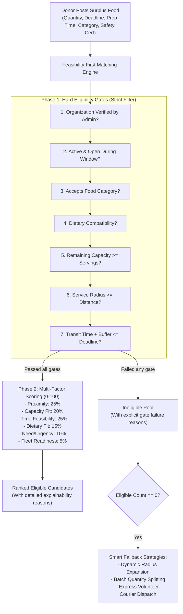
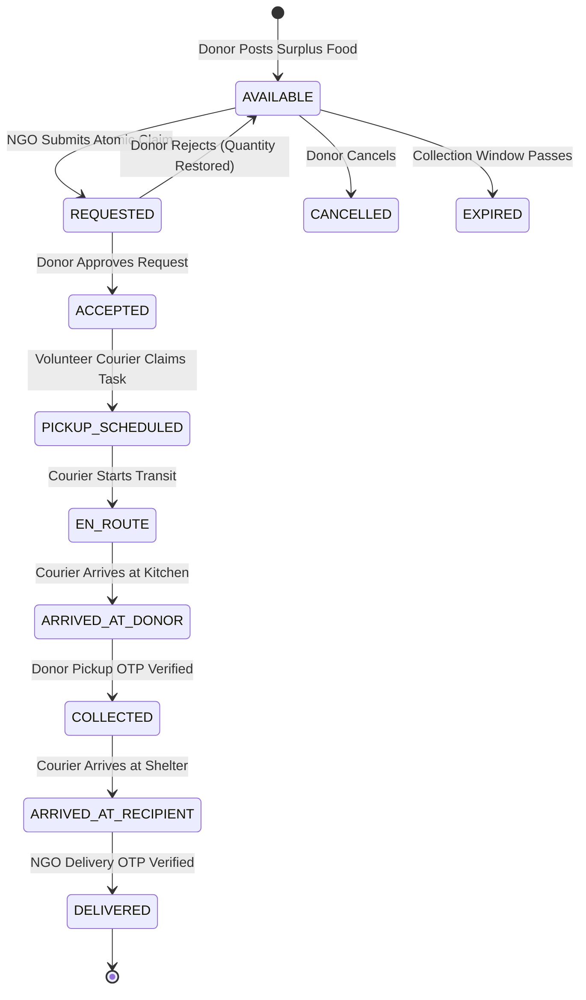

# FoodLoop — Intelligent Surplus Food Rescue Network
> **Rescue Surplus. Deliver Hope.**  
> *Connect surplus food from commercial kitchens with verified community organizations before the collection window closes.*

---

## 1. System Overview & The Core Innovation

**FoodLoop** is a production-ready, full-stack social-impact web application designed to eliminate edible food waste from restaurants, hotels, bakeries, caterers, and supermarkets by connecting them with verified shelters, community kitchens, and food distribution organizations.

### The Innovation: Feasibility-First, Deadline-Aware Matching Engine

Most existing platforms treat food donation like classified ads or sort by naive straight-line distance. This often leads to food spoiling during transit, shelters receiving items they cannot safely store (e.g., lack of refrigeration), or dietary mismatches (e.g., meat delivered to pure vegetarian shelters).

FoodLoop introduces a **deterministic, explainable two-phase decision engine**:



---

## 2. Technology Stack

- **Frontend**: React 18, Vite, Tailwind CSS, React Router v6, Lucide React, Recharts, Leaflet, React-Leaflet, Axios.
- **Backend**: Node.js, Express.js, MongoDB, Mongoose ORM.
- **Authentication & Security**: JWT with Bearer tokens, bcryptjs (salt factor 10), Helmet HTTP security headers, Express Rate Limiter, CORS protection.
- **Handover Security**: Cryptographic SHA-256 verification codes (dual 6-digit OTP verification at collection & delivery).
- **Testing**: Jest test runner, Node.js native test suite.

---

## 3. Four User Roles & Server-Enforced Permissions

| Role | Primary Dashboard & Capabilities |
| :--- | :--- |
| **Donor** | Post surplus batches with mandatory food safety declarations; view ranked recipient recommendations; approve or decline NGO claim requests; inspect courier pickup OTP code; review donation history & metrics. |
| **Recipient NGO** | Onboard organization & submit verification credentials; set daily capacity and accepted categories; browse live map of available donations; submit atomic claim requests; inspect delivery OTP code. |
| **Volunteer** | Set vehicle profile & service radius; browse available courier tasks; accept missions; step through custody state machine (`EN_ROUTE` → `ARRIVED_AT_DONOR` → `COLLECTED` via donor OTP → `ARRIVED_AT_RECIPIENT` → `DELIVERED` via recipient OTP). |
| **Administrator** | Audit pending recipient organization applications (approve/reject); manage users (suspend/reactivate); inspect system-wide audit logs; monitor platform health metrics. |

---

## 4. Custody Handover State Machine & Security Model



### Fraud Prevention via Dual Cryptographic OTPs
1. **Pickup Verification OTP**: A 6-digit code provided exclusively to the Food Donor. When the volunteer arrives, the donor inspects their badge and supplies this OTP. The server verifies it against `pickupVerificationCodeHash`.
2. **Delivery Verification OTP**: A 6-digit code provided exclusively to the Recipient NGO. When the food arrives, the shelter representative inspects the tamper-evident containers and provides this OTP to mark the mission `DELIVERED`.

---

## 5. Pre-Seeded Demonstration Accounts

For hackathon judges and evaluators, the application includes a **One-Click Role Switcher** in the top navigation bar and the login screen:

| Role | Email | Password | Organization | Status |
| :--- | :--- | :--- | :--- | :--- |
| **Donor** | `donor@foodloop.org` | `Password123!` | Spice Garden Restaurant | Active / Verified |
| **Recipient NGO** | `ngo@foodloop.org` | `Password123!` | Hope Community Shelter | Active / Verified |
| **Volunteer** | `volunteer@foodloop.org` | `Password123!` | Courier Fleet | Active |
| **Admin** | `admin@foodloop.org` | `Password123!` | Platform Governance | Active / Auditor |
| **Pending NGO** | `unverified@foodloop.org` | `Password123!` | Eastside Community Relief | Pending Verification Gate |
| **Low-Capacity NGO**| `lowcap@foodloop.org` | `Password123!` | Sunrise Children Haven | Capacity Gate Test (8 left) |

---

## 6. Installation & Local Run Instructions

### Prerequisites
- Node.js v18+ or v20+
- MongoDB running locally on port 27017 (`mongodb://127.0.0.1:27017/foodloop`)

### Step 1: Install Dependencies
```bash
# Backend dependencies
cd backend
npm install

# Frontend dependencies
cd ../frontend
npm install
```

### Step 2: Seed the Database
```bash
cd ../backend
npm run seed
```
*Populates restaurants, verified shelters, capacity-constrained NGOs, unverified organizations, active donations, near-deadline items, and historical completed missions.*

### Step 3: Run Automated Tests
```bash
# Run unit & matching engine tests
cd backend
npm test

# Run complete end-to-end scenario verification script
node src/tests/e2eDemo.js
```

### Step 4: Start Backend and Frontend
In Terminal 1 (Backend):
```bash
cd backend
npm start
# Server starts on http://localhost:5000
```

In Terminal 2 (Frontend):
```bash
cd frontend
npm run dev
# Frontend starts on http://localhost:5173
```

Open `http://localhost:5173` in your browser.

---

## 7. REST API Documentation

| Method | Endpoint | Access | Purpose |
| :--- | :--- | :--- | :--- |
| `POST` | `/api/auth/register` | Public | Register new user and optional organization profile |
| `POST` | `/api/auth/login` | Public | Authenticate user & return JWT token |
| `GET` | `/api/auth/me` | Private | Retrieve active user profile & organization |
| `POST` | `/api/donations` | Donor | Create surplus food donation with safety certification |
| `GET` | `/api/donations` | Public | List available surplus food with filters & distance |
| `GET` | `/api/donations/:id` | Public | Get single donation details |
| `POST` | `/api/donations/:id/cancel` | Donor/Admin | Cancel an available donation |
| `GET` | `/api/matching/:donationId` | Private | Execute feasibility-first matching engine & explainability |
| `POST` | `/api/donations/:id/requests`| Verified NGO | Claim surplus portions (atomic reservation) |
| `PATCH`| `/api/requests/:id/accept` | Donor | Accept claim & auto-provision pickup with OTPs |
| `PATCH`| `/api/requests/:id/reject` | Donor | Reject claim & re-credit portions to inventory |
| `GET` | `/api/pickups` | Private | List accessible pickup missions by user role |
| `POST` | `/api/pickups/:id/assign` | Volunteer | Volunteer claims/accepts pickup courier mission |
| `PATCH`| `/api/pickups/:id/status` | Volunteer | Update mission transit state (`EN_ROUTE`, `ARRIVED`) |
| `POST` | `/api/pickups/:id/verify-handover` | Volunteer | Verify 6-digit OTP code at pickup or delivery |
| `POST` | `/api/pickups/:id/discrepancy` | Private | Report food condition or quantity discrepancy |
| `GET` | `/api/analytics/overview` | Public/Auth | Aggregate platform impact and role-specific stats |
| `GET` | `/api/admin/verifications` | Admin | Queue of pending NGO applications |
| `PATCH`| `/api/admin/organizations/:id/verification` | Admin | Approve or reject organization verification |
| `GET` | `/api/admin/audit-logs` | Admin | Searchable, paginated immutable audit logs |
| `GET` | `/api/admin/users` | Admin | User accounts directory with status toggling |

---

## 8. Environmental Impact Methodology

FoodLoop calculates environmental and social impact strictly from verified, completed deliveries:
- **Rescued Food**: Only counted once the Recipient NGO enters the 6-digit Delivery OTP. Cancelled or expired batches are excluded.
- **Emissions Avoidance**: Based on the UN Food and Agriculture Organization (FAO) Food Wastage Footprint benchmark, avoiding 1 prepared meal portion from reaching landfills prevents an estimated **~0.85 kg CO₂ equivalent**.

---

## 9. Known Limitations & Roadmap

- **Simulated Real-Time Couriers**: In local demonstration mode, courier locations are simulated along the route coordinates. In production, real-time WebSockets and mobile GPS updates would be integrated.
- **SMS / Push Fallback**: The current prototype uses in-app polling notifications. SMS gateways (e.g. Twilio) can be plugged in for couriers in low-connectivity areas.
- **Cold-Chain Sensor Integrations**: IoT temperature loggers can be linked to the handover verification workflow for continuous chilled monitoring.

---

© 2026 FoodLoop — Intelligent Surplus Food Rescue Network. Open and auditable.
